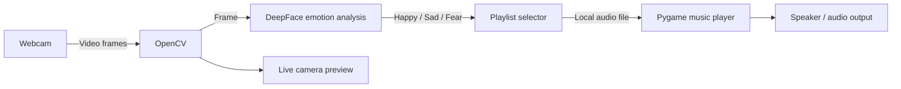
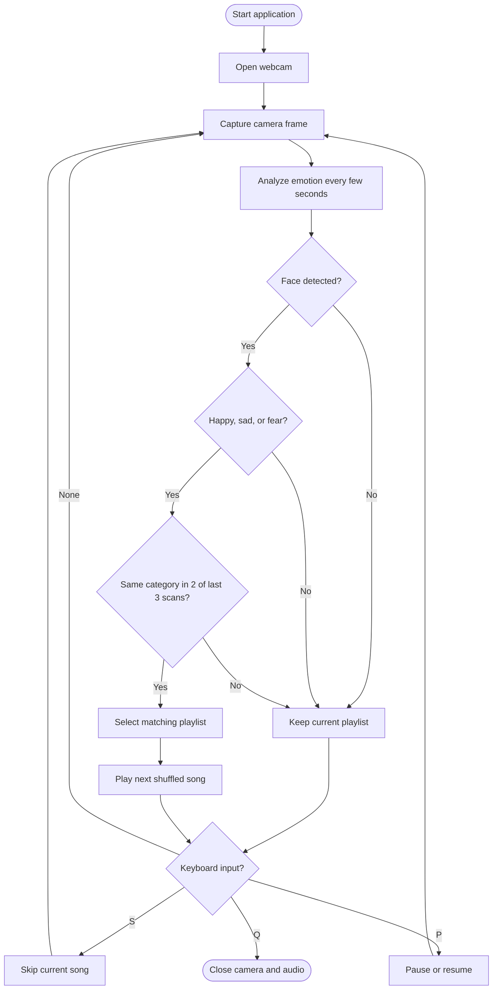

# Emotion-Based Music Player Using Raspberry Pi 4

A webcam-based music player that analyzes facial expressions with DeepFace and selects songs from local playlists. OpenCV captures the camera feed, DeepFace estimates facial emotion, and Pygame plays music from the matching folder.

This project was built around a Raspberry Pi 4 and a webcam. The example configuration includes playlists for **happy**, **sad**, and **fear**. Add your own music files to those folders.

> Facial-expression software estimates visible expressions. Its output may not reflect how a person actually feels. This project is for demonstration and learning, not diagnosis.

## Features

- Captures live video from a USB webcam
- Uses DeepFace to estimate facial emotion
- Selects local playlists for happy, sad, and fear categories
- Requires the same playlist category in at least two of the last three scans before switching, to reduce rapid changes
- Shuffles tracks and cycles through each category before repeating songs
- Supports `mp3`, `wav`, and `ogg` files
- Displays the camera feed, detected emotion, active category, and current song
- Press `Q` to quit, `S` to skip, and `P` to pause or resume

## System Diagram



## Processing Flow



## Project Structure

Keep the folders next to `emotion_music_player.py`. Folder names are case-sensitive on Raspberry Pi OS.

```text
emotion-music-player/
├── emotion_music_player.py
├── Playlist/
│   ├── Happy/
│   │   ├── happy-song-1.mp3
│   │   └── happy-song-2.ogg
│   ├── Sad/
│   │   └── sad-song-1.mp3
│   └── Fear/
│       └── fear-song-1.ogg
└── README.md
```

The program scans these folders automatically. Put audio files directly inside each folder; nested folders are not scanned.

## Requirements

- Raspberry Pi 4 running Raspberry Pi OS with a desktop session
- USB webcam (or another camera available to OpenCV)
- Speaker, headphones, or another configured audio output
- Python 3
- DeepFace, OpenCV, and Pygame
- Internet access for package installation and, if needed, DeepFace model downloads on first run

DeepFace analysis can be computationally intensive on a Raspberry Pi 4. This program limits frame width and runs analysis every three seconds to reduce load. Processing speed depends on the Pi OS image, Python and library versions, camera, and model backend.

## Installation

On Raspberry Pi OS Bookworm and newer, install Python packages inside a virtual environment:

```bash
sudo apt update
sudo apt install -y python3-full python3-venv python3-pip
```

From the project folder, create and activate the environment, then install the libraries:

```bash
python3 -m venv .venv
source .venv/bin/activate
python -m pip install --upgrade pip
python -m pip install deepface opencv-python pygame
```

Run the player from the project folder:

```bash
python emotion_music_player.py
```

The camera preview needs a graphical desktop session. If the webcam is not `/dev/video0`, change `CAMERA_INDEX` near the top of the script (usually `0` for the first camera or `1` for the second).

## Emotion-to-Playlist Mapping

The script maps only these DeepFace labels to playlists:

| Detected label | Folder |
|---|---|
| `happy` | `Playlist/Happy/` |
| `sad` | `Playlist/Sad/` |
| `fear` | `Playlist/Fear/` |

Other labels such as `angry`, `neutral`, `surprise`, or `disgust` do not switch the playlist. The currently playing category continues. To add a category, create its folder and update `EMOTION_TO_PLAYLIST` and `PLAYLISTS` in the Python script.

When multiple faces appear, the largest detected face determines the playlist.

## Controls

| Key | Action |
|---|---|
| `Q` | Quit and close the webcam preview |
| `S` | Skip to the next song in the active category |
| `P` | Pause or resume the current song |

## Troubleshooting

- **No webcam opens:** Check that the camera is connected and available, then try another `CAMERA_INDEX`.
- **No face is detected:** Improve lighting, face the camera, and ensure the full face is visible.
- **No songs play:** Check that the folder names match the structure above and contain supported audio files.
- **No audio output:** Check the Raspberry Pi's selected audio output and volume.
- **Slow emotion analysis:** Reduce camera resolution or increase `ANALYSIS_INTERVAL_SECONDS` in the script.
- **Package installation fails:** Raspberry Pi package availability depends on OS, CPU architecture, and Python version. Use a virtual environment and check the package's current installation instructions.

## Privacy

The script does not save camera frames or send them to a server. DeepFace processes frames locally; the first run may download model files. Review library behavior and your own device configuration before using the project with other people.

## Acknowledgements

- [DeepFace](https://github.com/serengil/deepface)
- [OpenCV](https://opencv.org/)
- [Pygame](https://www.pygame.org/)
- [Raspberry Pi OS Python documentation](https://www.raspberrypi.com/documentation/computers/os.html#use-python-on-a-raspberry-pi)
